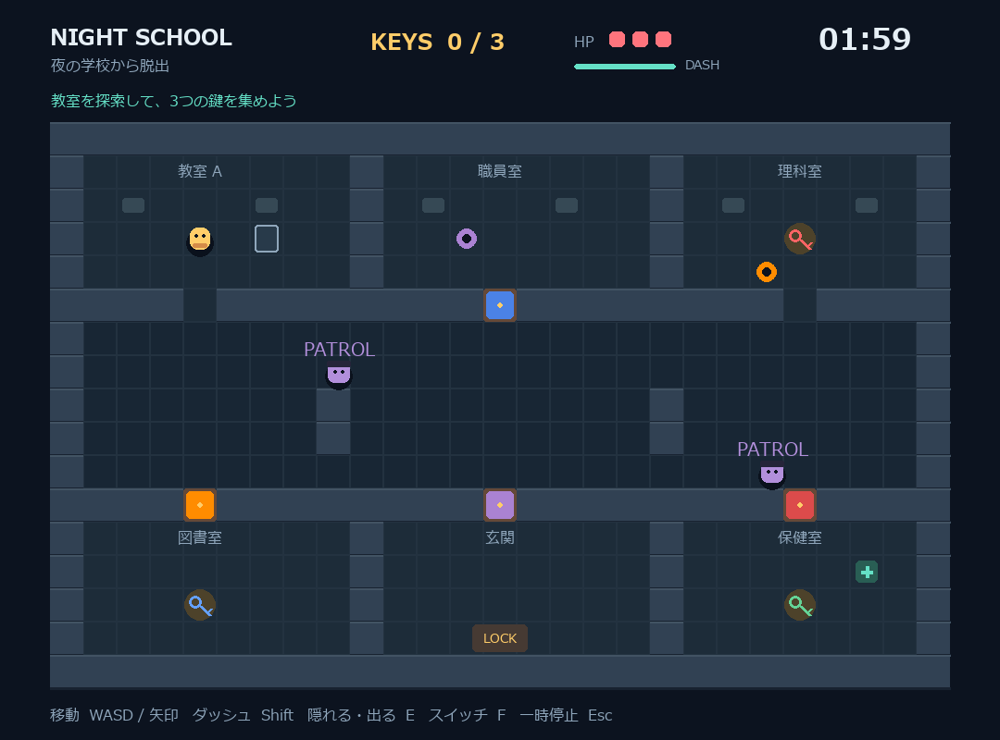

# 夜の学校から脱出 - School Escape Demo

## 実行環境の必要条件
- python >= 3.10
- pygame >= 2.1
- 日本語表示に対応したフォント

## ゲームの概要
- 夜の学校を舞台に、制限時間120秒以内に3つの鍵を集めて脱出するゲームです
- プレイヤーは校舎内を探索し、見回り役に捕まらないように鍵を集め、下中央の玄関から脱出します。見回り役に接触するとHPが減少し、HPが0になるか制限時間が終了するとゲームオーバーとなります
- タイトル画面で校舎Aと校舎Bの2種類のステージを選択できます

## ゲームの遊び方
- タイトル画面で1または2を押してステージを選択し、Enterキーまたは開始ボタンでゲームを開始する
- WASDキーまたは矢印キーでプレイヤーを移動する
- Shiftキーを押しながら移動すると、スタミナを消費してダッシュできる
- ダッシュでスタミナを使い切ると、30%まで回復するまで再使用できない
- 校舎内に配置された3つの鍵に触れると、自動的に取得できる
- 鍵を3つ集めた状態で玄関に到達するとゲームクリアとなる
- 見回り役は紫色のPATROLで巡回し、主人公を発見すると赤色のCHASEで追跡する。見失うと黄色のSEARCHで最後に見た場所の周囲を探す
- プレイ中にNキーを押すと、敵の反応確認用の仮の足音を発生させる（効果音は鳴らない）
- HPは初期状態で3あり、見回り役との接触で1減少する
- ダメージを受けた後は3秒間の無敵時間が発生し、接触した見回り役は1秒間停止する
- 校舎Aの保健室、校舎Bのエントランスホールにある回復アイテムで、HPを一度だけ1回復できる
- Escキーで一時停止と再開を切り替えられる
- 結果画面ではRキーまたはEnterキーで同じステージに再挑戦でき、Tキーでタイトル画面に戻れる
- 別のウィンドウに切り替えた場合は、自動的に一時停止する

## ゲームの実装

### 共通基本機能
- Pygameを使用したゲーム画面、タイトル画面、結果画面の表示
- プレイヤーキャラクターの描画と移動処理
- 壁との衝突判定と通行制限
- 鍵の取得処理と脱出判定
- HP、ダメージ、無敵時間、回復処理
- スタミナを消費するダッシュ機能
- 120秒の制限時間とゲームクリア・ゲームオーバーの判定
- 見回り役の巡回、プレイヤーの発見、追跡処理
- 一時停止、再開、再挑戦の処理

### 分担追加機能
- マップ・ステージ機能（担当：kusupon）：固定マップ、座標変換、経路探索、視線判定などをWorldクラスにまとめ、複数ステージを管理する機能
  - 片柳研究棟マップを追加しました
  - 片柳研究棟にはE101〜E104講義室、エントランスホール、バイオホール、中庭などを配置してあります
  - Worldクラスで通行判定、経路探索、視線判定、扉の開放状態を管理しています
  - ステージ作成時に配置の妥当性を検証し、範囲外の配置や進行不能などを検出しています
  - 新しいステージを追加できるように、地形やアイテム配置をstages.pyで管理しています

### 敵の探索・追跡AI（担当：C0A25107 / c0a25107a3）

第5回に実装した敵AIを、代表者のWorld・Player・NoiseEventに接続しました。

| 状態 | 行動 | 表示色 |
|---|---|---|
| PATROL | ステージで指定された経路を巡回する | 紫 |
| CHASE | 見えている主人公を追跡する | 赤 |
| SEARCH | 最後に見た場所や音がした場所の周囲を探す | 黄 |

- 壁・閉じた扉・経路・座標の判定には、現在のステージのWorldを使います。
- 主人公が隠れておらず、185ピクセル未満で視線が通る場合に発見します。
- 主人公を見失うと最後に見た場所へ向かい、その上下左右の通れるマスを順番に調べます。
- 捜索先に到着してから約3秒で巡回へ戻り、途中で主人公を再発見すると追跡へ戻ります。
- 音の位置と届く距離を受け取り、その位置の捜索を開始します。主人公が見える場合は追跡を優先します。
- 敵の頭上に現在の状態名を表示します。

#### 敵AIの確認方法

1. タイトルで1・2を選び、両ステージで敵が巡回することを確認する。
2. 敵に近づいてCHASEになり、壁の陰へ逃げるとSEARCHになることを確認する。
3. 敵が最後に見た場所へ向かい、周囲を歩いた後にPATROLへ戻ることを確認する。
4. SEARCH中に敵の視界へ出ると、再びCHASEになることを確認する。
5. 敵の近くで壁に隠れてNキーを押すと、その音の位置を探すことを確認する。
6. 敵から240ピクセルより遠い場所のNキーには反応せず、見られているときは追跡が優先されることを確認する。
7. 再挑戦すると、敵の状態がPATROLから始まることを確認する。

#### 主人公担当との接続

- Guard.updateは、Player・World・NoiseEventの一覧を受け取ります。
- Player.updateが返すNoiseEvent（positionとradius）は、Gameから敵へ渡されます。
- 現時点のPlayer.updateは音の通知を返さないため、走行時の足音発生は主人公担当の実装後に確認します。
- Nキーは動作確認用で、効果音は鳴りません。音は距離で判定し、壁越しにも届きます。
- player.hiddenがTrueの主人公は視認しません。隠れる操作自体は別担当との統合時に確認します。

### メモ

### 実行方法

Windowsの場合は、プロジェクトのフォルダで以下を実行する。

    py -3.13 -m venv .venv
    .\.venv\Scripts\python.exe -m pip install -r requirements.txt
    .\.venv\Scripts\python.exe game.py

初回設定後は`run_game.cmd`からも起動できる。

macOS / Linuxの場合は、以下を実行する。

    python3 -m venv .venv
    .venv/bin/python -m pip install -r requirements.txt
    .venv/bin/python game.py

自動テストは以下のコマンドで実行する。

    python -m unittest discover -s tests -v